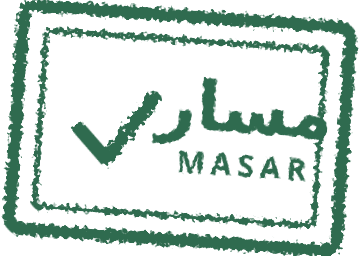

<p align="center">
  
</p>

# Masar | مسار

A web app that guides entrepreneurs in Saudi Arabia through every license they need to open their business. Describe your project in a chat, and Masar builds a step-by-step roadmap with the cost, duration, and how to get each license, all from official government sources.

Built solo at the **AI Training Hackathon**, organized by Kanz with the Ministry of Human Resources and Social Development and the Lebanese American University. It received a **Gold evaluation**, the highest level awarded.

**[Live demo](https://lnkd.in/dJJ4U36W)**


## What it does

- **Chat to a roadmap:** tell the assistant what you want to open (café, restaurant, salon, online store). It asks only the questions that change your licenses, such as online or physical location.
- **Only what you need:** licenses that do not apply to you are left out of the roadmap, and the assistant tells you what it saved you.
- **Every license in detail:** definition, numbered steps, prerequisites, a merchant tip, cost, duration, and a link to the official source with the date it was last verified.
- **PDF export** of the full plan, and Arabic (RTL) or English with one click.

## Accuracy first

The assistant never answers from the model's general knowledge. It works through three tools (`classify_activity`, `build_roadmap`, `get_license_details`) that read from local JSON files, so every fact comes from data we collected from official sources (business.sa, balady.gov.sa, zatca.gov.sa, saip.gov.sa). If a cost or duration is not confirmed, the app shows it as "approximate, check with the authority" instead of making up a number. If you ask about an activity we do not cover, it says so politely.

## Tech stack

Next.js (App Router), TypeScript, Tailwind CSS, shadcn/ui, Claude API with tool use, local JSON data (no database).

## Run it locally

You need Node.js 20+ and an [Anthropic API key](https://console.anthropic.com/).

```bash
git clone https://github.com/FaiAlharthi/masar.git
cd masar
npm install
cp .env.local.example .env.local   # then add your ANTHROPIC_API_KEY
npm run dev
```

Open http://localhost:3000.

## API reference

There is one endpoint, used by the chat panel.

**`POST /api/chat`**

```json
// request
{
  "messages": [{ "role": "user", "content": "I want to open a café" }],
  "locale": "en"
}
```

```json
// response
{
  "reply": "Your roadmap is ready on the right...",
  "open_card": "license_id or null",
  "roadmap": { "activityId": "...", "caseKey": "online", "licenses": [ ... ] }
}
```

`locale` is `"ar"` (default) or `"en"`. `roadmap` is `null` until the assistant has collected all answers. `open_card` tells the UI which license card to expand. Errors return `400` if `messages` is missing and `500` on a server error.

## Data

Two files in `data/`:

- `licenses.json`: every license with names, authority, official URL, steps, prerequisites, cost, duration, and `last_verified`.
- `activities.json`: each business type, its customization questions, and which licenses apply for each combination of answers.

Covered today: online store, café, restaurant, and salon. Adding an activity means adding data only, with no code changes.

## What I would improve next

- Cover more business types with the same level of verification.
- Add tests for the roadmap logic in `src/lib/data.ts`.
- Rate-limit `/api/chat` before deploying publicly.

## Author

Designed and built by [Fai Alharthi](https://github.com/FaiAlharthi).
